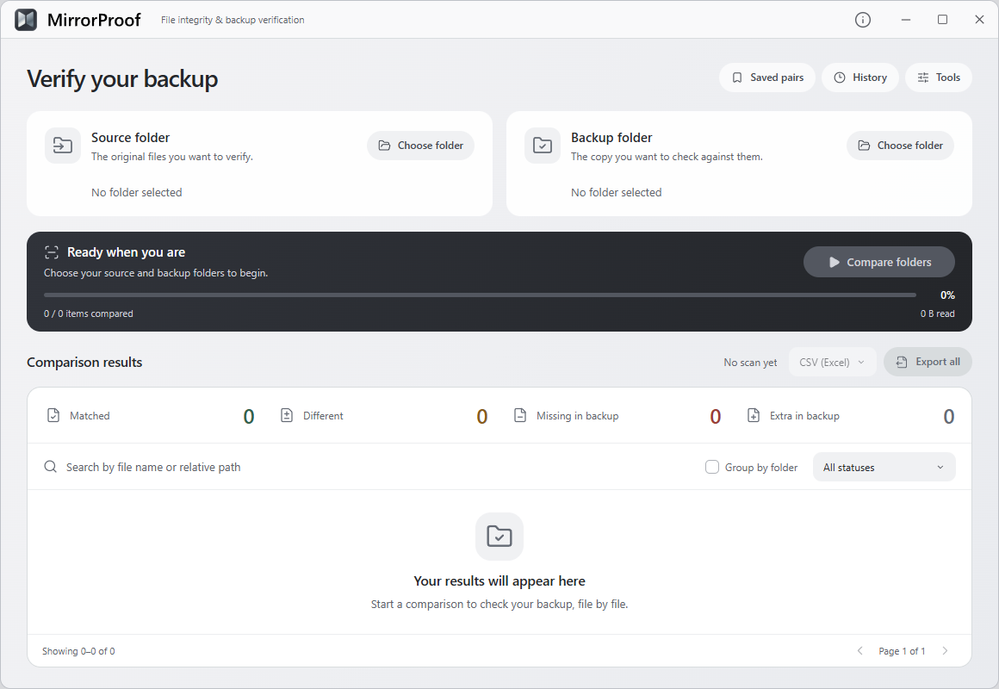
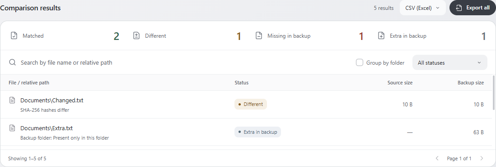
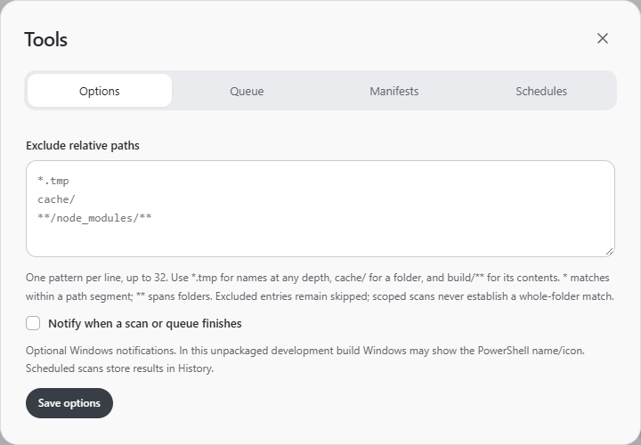
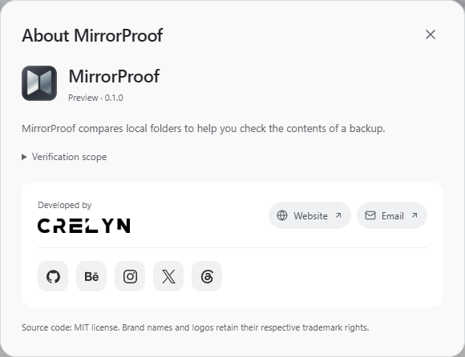

# MirrorProof

File integrity and backup verification for Windows 10/11. **Preview 0.1.0 — an early release for testing and feedback.**

MirrorProof compares a source folder with a backup folder, including subfolders. A file is marked **Matched** only after both files produce the same SHA-256 digest. Equal sizes alone never establish a match.

## Download for Windows

[Download the Windows x64 installer — 1.71 MB](https://github.com/crelynstudio/crelyn-studio-mirrorproof/releases/download/v0.1.0-preview.1/MirrorProof_0.1.0-preview_x64-setup.exe)

See the [preview release notes](https://github.com/crelynstudio/crelyn-studio-mirrorproof/releases/tag/v0.1.0-preview.1), [installation notes](https://github.com/crelynstudio/crelyn-studio-mirrorproof/releases/download/v0.1.0-preview.1/INSTALL.txt) and [SHA-256 checksum](https://github.com/crelynstudio/crelyn-studio-mirrorproof/releases/download/v0.1.0-preview.1/SHA256SUMS.txt). Requires Windows 10/11 x64 and WebView2. Setup downloads WebView2 only when missing; once present, the app works offline. The preview is unsigned, so Windows may show a SmartScreen/unknown-publisher prompt.



## Features

- Native Windows folder selection and recursive comparison of local folders.
- SHA-256 verification; matched, different, missing and extra files.
- Separate access/scan errors, skipped items and unverified results.
- Progress and cancellation. Completed results remain available as a **Partial scan**.
- Live elapsed time, recent read speed and a remaining-read estimate once enough samples are available.
- File-name/path search, status filters and 100 results per page.
- Problems-only filtering and folder grouping, compatible with search and pagination.
- Click a result to inspect full paths, recorded sizes and the verification/error reason; copy either path.
- Reveal an existing result item in Windows Explorer without opening the file.
- Save up to 20 named folder pairs locally and load them for a new comparison.
- Sequential scanning of selected saved pairs, with separate outcomes and cancellation of remaining work.
- Local scan history, reopening/import of validated JSON reports and comparison of recorded outcomes.
- Exclusion patterns with explicit skipped results and scoped coverage.
- Create/verify SHA-256 manifests for a single folder, including incomplete-baseline handling.
- English-only interface with restrained silver, white and graphite surfaces, larger system typography, flat controls, an integrated results panel, coordinated Windows icons, keyboard focus indicators and reduced-motion support.
- Custom minimize, maximize/restore and close controls. Main controls fit the window; the results list scrolls within its own area.
- CSV, JSON or standalone printable HTML export of the entire completed or cancelled scan, independent of the current filters and page.
- Optional completion notifications and daily/weekly current-user Windows schedules with a windowless scan runner.
- Source/backup files are never changed. Exports create new reports outside both folders; existing files are never overwritten.



Screenshots show the running Windows prototype and real scans of deliberately prepared example files, not actual user backup data.

## Run and develop

Development requires Windows x64, Node.js 24 LTS with npm, Rust's stable MSVC toolchain, Microsoft C++ Build Tools with the Windows SDK, and Microsoft Edge WebView2 Runtime. Follow the [official Tauri prerequisites](https://v2.tauri.app/start/prerequisites/).

From this repository directory:

```powershell
npm ci
npm run desktop
```

Build and open a development executable with the frontend embedded:

```powershell
npm run tauri -- build --debug --no-bundle
.\src-tauri\target\debug\mirrorproof.exe
```

The executable starts independently of Vite and Node.js, but requires Windows and WebView2. Development output is not the downloadable application package.

Build the optimized Windows installer:

```powershell
npm run package:windows
```

The NSIS setup is generated in `src-tauri/target/release/bundle/nsis/`. It uses LZMA compression, English-only setup, the MirrorProof icon and Crelyn Studio publisher metadata. Installation is for the current Windows user; no account or API is needed. WebView2 is detected and downloaded only when missing, so a computer without it needs internet during the first installation. Once the runtime is present, MirrorProof works offline. The large WebView2 offline/fixed runtime is deliberately not embedded in the download.

The preview installer is unsigned. Windows may show an unknown-publisher/SmartScreen prompt; a SHA-256 checksum establishes file integrity, not publisher authenticity. No signing certificate, updater, web edition or GitHub workflow is included. Uninstall removes the program and its owned schedules, while local reports/preferences remain available. No compared source/backup files are modified by installation or uninstall.

The measured preview setup is **1,705,719 bytes (1.71 MB)**; its application executable is **5,500,416 bytes (5.50 MB)**. The previous development executable was 16,219,136 bytes. Release builds optimize most code for size while retaining speed optimization for SHA-256. See the [size measurements and validation record](docs/validation.md) for the workload, checksums and remaining checks. These sizes exclude the separately installed/shared WebView2 runtime and user-created history/reports.

Only repository sources belong in the GitHub source repository. `node_modules`, `dist`, `src-tauri/target` and generated schemas are reproducible build outputs and are excluded from source delivery. Run `npm ci` to restore JavaScript development dependencies; the documented Rust toolchain restores its own dependencies. The parent workspace's local compiler/SDK tools and preview installer are separate from this repository.

## File details and saved pairs

Click a result row or focus its file-name button and press Enter to open **File details**. Both full paths, scan-time sizes and the status/reason are shown. Missing counterparts are labelled **Expected path**. **Copy path** copies text only; it does not open or modify a file. Close with the close button or Escape.

Choose both folders, open **Saved pairs**, enter a name and choose **Save pair**. Names must be unique without regard to case. **Load** selects the folders and clears the previous comparison; scanning starts only when you choose **Compare folders**. **Remove saved pair** removes that saved entry only. The next scan always checks whether the folders are still accessible and safe.

Pairs are stored in WebView2's local application storage under `mirrorproof-saved-pairs-v1`. They contain names and absolute folder paths, not file contents or scan results. They survive restarts in the same Windows user profile. Clearing application storage removes them. Storage failures are reported and existing malformed data is not silently replaced.

While scanning, elapsed time updates twice per second. Speed reflects recent content reads over up to eight seconds. The remaining-time estimate needs at least three seconds of samples; it covers planned remaining content reads, not discovery or final folder checks. It is approximate, can change with storage speed/errors, and disappears on completion/cancellation. A stalled read returns to **Estimating…**. Completed/partial scans show total elapsed time and average speed instead.

## History and result changes

Completed and cancelled folder/manifest verifications are recorded under `%LOCALAPPDATA%\Crelyn Studio\MirrorProof\history`. Failed folder scans retain a lightweight error record where possible. **History** shows the latest 100 records; older files are retained, not automatically deleted. History cannot be written inside either compared root. If saving fails, the current result remains available for export and the app reports the failure.

Open a saved result or choose **Open JSON report**. Imports are limited to 128 MiB and validate the schema, relative paths, reason/status fields and count consistency. Old source/reference folders need not be present. **Historical result** identifies archived observations; opening a report does not rehash files. Reports and manifests are unsigned documents: their origin/authenticity is not established by importing them.

Select two reports for the same folders, mode and exclusion rules, then choose **Compare results**. Changes describe recorded statuses, reasons and sizes; unchanged statuses do not prove unchanged file contents between runs. An item absent from a partial report is **No longer recorded**, not inferred to be deleted. Search covers all changes; the dialog displays the first 200 matching rows.

## Tools

**Options:** Add up to 32 exclusion rules, one per line (240 UTF-8 bytes each). `*.tmp` matches names at any depth, `cache/` skips matching entries/subtrees, and `build/**` matches descendants. `*` stays within a path segment, `**` spans folders, and `?` matches one character. Matching is case-insensitive; comparison of included relative paths still uses exact case. Excluded entries are **Skipped** and whole-folder integrity is never claimed for a configured scope. Options are saved locally and apply to future interactive scans/queues.

**Queue:** Select saved pairs in their listed order. Each pair runs through the real verification engine and gets its own history record. Errors are recorded and the queue continues; **Cancel scan** stops the current job and remaining pairs. **Last queue results** links to saved outcomes. Closing the application ends an interactive queue.

**Manifests:** Choose a folder and **Create manifest** to record actual SHA-256 digests for ordinary files. Save with a new `.json` name outside that folder. Cancelled creation writes no manifest. Read errors, skipped entries, exclusions and incomplete provenance are retained; such a baseline cannot establish a full match. **Verify folder** rehashes current contents using the baseline's exclusions and detects missing, extra, different and inaccessible items. Manifest results distinguish the current folder from the manifest reference. Digests/relative paths are validated; a manifest never directs writes to its source paths.

**Notifications:** Off by default. Enable explicitly under Options. Interactive scans/queues can send a completion/partial/failure notification. In an unpackaged Windows development build, Tauri notifications may use the PowerShell name/icon. Installed notification appearance/delivery remain a manual check. Scheduled jobs write results to History and do not send a notification.

**Schedules:** Select a saved pair, choose Daily or Weekly and a local time, then explicitly enable it. Windows Task Scheduler runs the same executable under your signed-in user with no password/elevation. Each schedule captures its folders/exclusions at creation; remove and recreate it to change them. Keep the executable at the registered location. Removed schedules cannot be run through their old plan ID. Configuration files are retained in the app's `schedules` directory with disabled markers; compared files are never deleted or changed. Removing a schedule prevents future runs but does not terminate an already-running job. No schedule is created by default.

The scheduler calls `MirrorProof.exe --scheduled <plan-id>` without creating a window or WebView. It saves real results to History; exit code 0 means a full match, 2 means differences/incomplete coverage, and 1 means the run/storage failed. The computer must be available and the user signed in; the app does not configure wake timers. Missed runs use Task Scheduler's start-when-available behavior. The setup uninstaller calls the windowless `--remove-schedules` command before removing the executable; failure stops uninstall so active tasks are not silently orphaned.



## Export reports

Complete or cancel a scan, select **CSV (Excel)**, **JSON** or **HTML**, then choose **Export all**. Save with a new name outside the compared folders. Search/status filters, grouping and pagination do not limit the report. HTML is a self-contained escaped document with print styles, no JavaScript or remote assets; use the browser's print function if a PDF is needed.

The formats include source/reference paths, Unix timestamps, summary counts, cancellation state, scope and item outcomes. CSV uses UTF-8 with a BOM for Excel; cells that could be interpreted as spreadsheet formulas are escaped. JSON preserves original text and includes a versioned schema and an `allFilesMatch` flag. Status/reason fields use stable English identifiers. A manifest reference records the baseline path and its completeness rather than pretending it is a second folder.

Cancelled scans are labelled `partial`. JSON's `allFilesMatch` remains false for partial scans, exclusions, incomplete baselines, errors, skipped/unverified items, differences or empty scans. Comparison reports record SHA-256 outcomes; raw digests are provided by the separate manifest format. An empty CSV scan contains a metadata row with blank item columns.

Reports contain absolute paths; share them only when you intend to disclose those paths. Export accepts new `.csv`/`.json`/`.html` files in local directories without links/junctions. A storage failure may leave an incomplete new report and is reported as a failure; existing files remain untouched.

## Tests

```powershell
npm run build
npm run test:ui
cargo test --manifest-path src-tauri/Cargo.toml --lib
cargo fmt --manifest-path src-tauri/Cargo.toml -- --check
cargo clippy --manifest-path src-tauri/Cargo.toml --all-targets -- -D warnings
```

Tests cover SHA-256's known `abc` vector, equal-size content differences, empty files, Unicode names, nested folders, missing/extra files, file/folder conflicts, changed files/directories, overlapping roots, cancellation, Windows file locks and junction loops. Export tests cover JSON/CSV output, partial/empty scans, CSV escaping, existing-file protection, source/backup protection, junction destinations and Windows stream/device syntax.

Frontend unit tests use Node.js 24's built-in TypeScript support and test timing/estimate boundaries, stalled reads, path formatting, saved-pair validation, storage failures and persistence.

Background native checks exercised real comparisons, saved-pair reload/removal, file details, Windows ACL/sharing errors, unavailable folders, live speed/ETA, cancellation, CSV/JSON/HTML exports, history, scoped scans, manifests, queued scans and a windowless scheduled run. The test task was registered with its trigger disabled, exercised explicitly through the runner, and removed; no enabled test task remains. Read-only preservation was checked against contents and modification times. Layouts were checked at 1160×800 and 760×640, plus 125%/150% device-scale emulation with reduced logical viewports. Emulation does not replace changing Windows display settings on real hardware. Clipboard/notification/external-link handlers used adapters; Explorer validation used a debug-only dry run to preserve the desktop. Actual OS dialogs, notifications, paste and Explorer UI still need manual testing.

The scale check creates and removes 200,000 real files (100,000 pairs), so it runs separately:

```powershell
cargo test --manifest-path src-tauri/Cargo.toml --lib hundred_thousand_files -- --ignored --nocapture
```

For a manual check, compare two test folders containing an extra file and a same-size content change. Open file details, copy both paths, check search/status filters and export both formats. Save a folder pair, restart, load it and verify scanning requires an explicit click. Cancel a scan of large files and confirm the **Partial scan** label and report state. Check the window at 125%/150% Windows display scaling and with a removable test drive; physical disconnect tests require separate hardware and have not been completed.

## Privacy and offline operation

All comparison happens on the device. There is no backend service, account, API key, cloud service, analytics, remote font or runtime CDN. History retains scan results and absolute paths in local application data. Saved pairs/options remain in local WebView2 storage; schedules retain a local plan and a Windows Task Scheduler entry. Exports/manifests are saved at explicitly chosen locations. **Copy path**, **Show in Explorer** and notifications act only through their explicit controls/settings. Windows/WebView2 may maintain their own caches.

Initial development setup downloads npm/Cargo dependencies. Once built, the executable includes the UI and works without an internet connection or an initial online application launch, provided WebView2 is already installed. Website/email links in **About** open only when clicked and use the corresponding browser/mail application.

Files are opened with read access only. Windows directory ancestors are checked without following reparse points and pinned during inspection. Compared file handles exclude writers/deleters while hashing. Busy or inaccessible files are errors, never verified matches.

## Preview limits

- Target: Windows 10/11 x64. Other operating systems and Windows on ARM have not been validated.
- Local fixed/removable/RAM disks only. UNC paths, mapped network drives and device paths are rejected.
- Relative paths use exact spelling and case. Case-only name changes appear as missing/extra; renames are not inferred.
- Symlinks, junctions and other reparse points, including cloud placeholders and mounted folders, are skipped. Root paths containing them are rejected. Skipped items prevent a full verification claim.
- If a subtree cannot be enumerated, absence there remains **Not verified** rather than missing/extra.
- Empty directories, permissions, backup timestamps, alternate data streams, hard-link relationships and other filesystem metadata are not verified. Only ordinary file contents are hashed.
- Directory entries are checked again at the end for additions/removals. This is a live scan, not a filesystem snapshot; results describe files when read. Avoid editing the folders during a scan.
- Traversal stops at nesting depth 128. Inventories/results use memory proportional to item count; file contents are read in 1 MiB chunks. The first scale target is 100,000 files, not a hard limit or universal performance promise.
- No automatic repair, deletion, synchronization, pause/resume across restarts or cloud storage is included.
- History shows the latest 100 entries; result comparisons display up to 200 search matches. Local JSON imports/manifests are limited to 128 MiB. History/configuration records are retained without automatic pruning.
- Schedules require the executable to remain available and the user to be signed in. Changes made directly in Windows Task Scheduler can diverge from stored plans; use the app to remove/recreate schedules.

## Architecture

Tauri 2 hosts React + TypeScript + Vite. `src-tauri/src/engine.rs` performs pinned read-only inspection/hashing; `engine/manifest.rs` builds/verifies digests; `scope.rs` implements bounded exclusion matching. `reports.rs` formats/validates snapshots and protected exports, `history.rs` stores local records, and `schedules.rs` manages fixed-script Task Scheduler integration and windowless execution. User paths are passed as data, never interpolated into shell code. `lib.rs` exposes native commands/progress. React dialogs connect these real operations to the existing workspace; `resultChanges.ts`, `pairStorage.ts`, `preferences.ts` and `scanStats.ts` contain focused testable helpers. Versions/lockfiles are included; runtime assets are contained in this repository.

## Developer and license

**Developed by Crelyn Studio.** [Website](https://crelynstudio.com) · [Email](mailto:info@crelynstudio.com)



Source code is under the [MIT license](LICENSE). Crelyn Studio's name, brand marks and supplied logos retain their separate brand/trademark rights; the software license does not grant unrestricted branding rights. Lucide icons use their upstream ISC license; dependencies retain their respective licenses.

See [third-party notices](THIRD-PARTY-NOTICES.md) and the generated [full runtime license inventory](docs/ThirdPartyLicenses.html). These documents are included with the installed application.

The About card bundles five platform logos from [Simple Icons 16.36.0](https://github.com/simple-icons/simple-icons/tree/16.36.0) as local SVG assets under [CC0-1.0](src/assets/platforms/LICENSE.md). Their respective trademark rights remain with their owners. No icon CDN or network request is required to display them.
